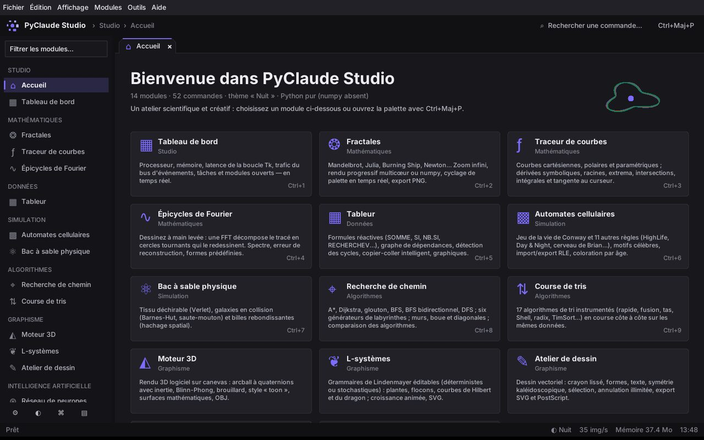
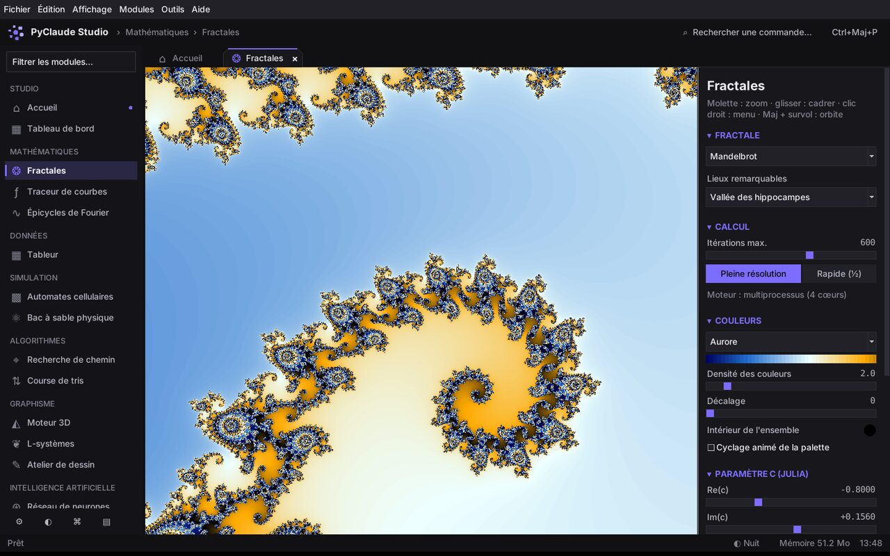
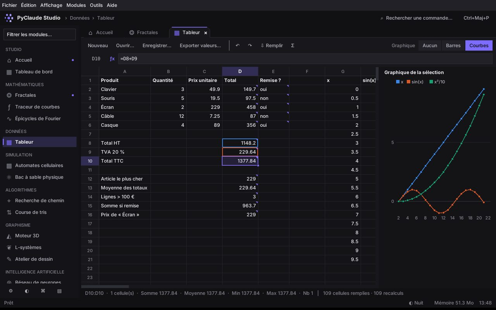
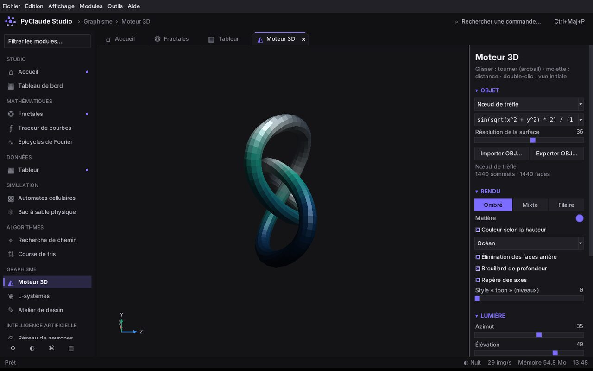
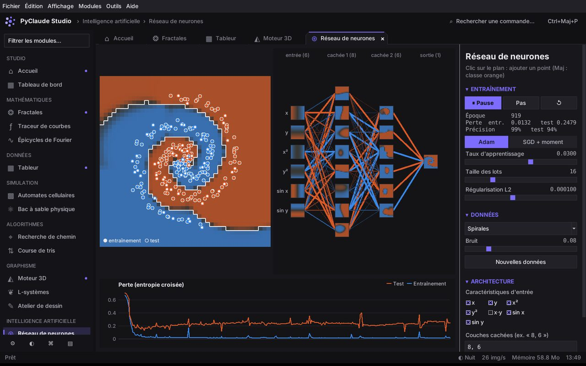
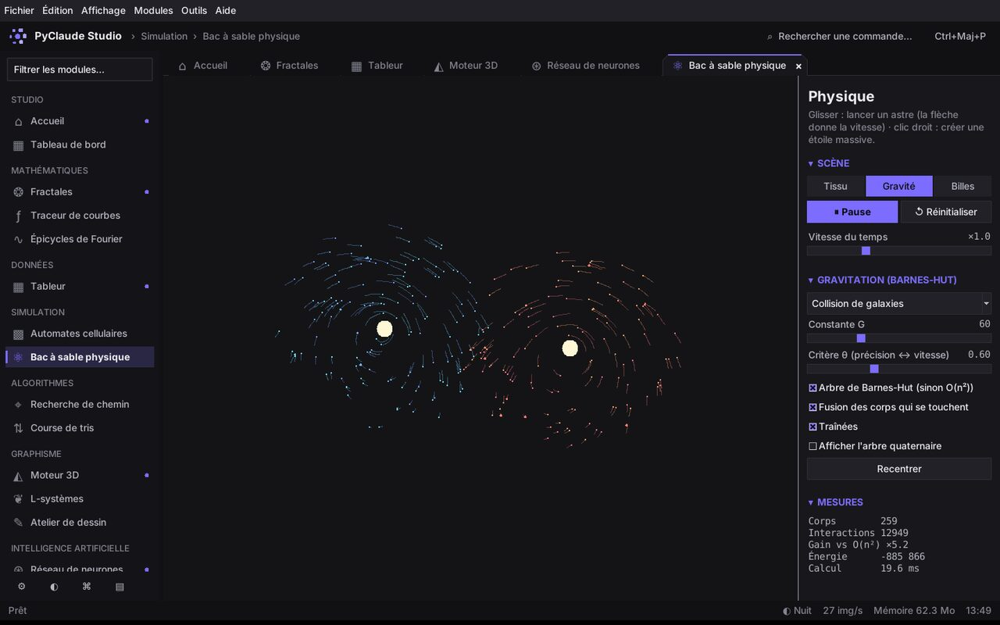
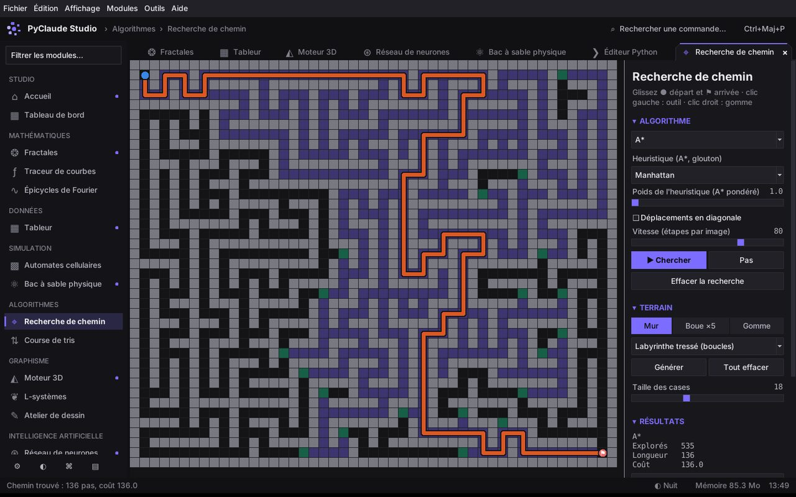
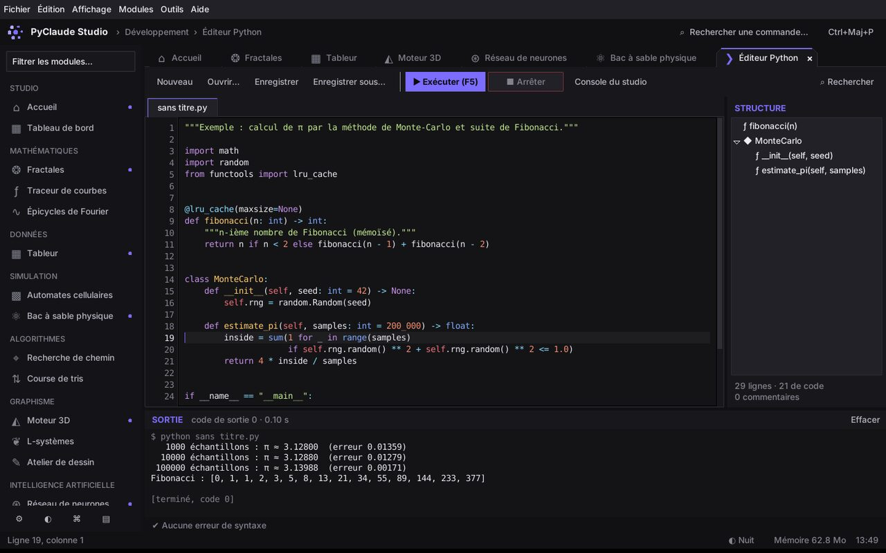
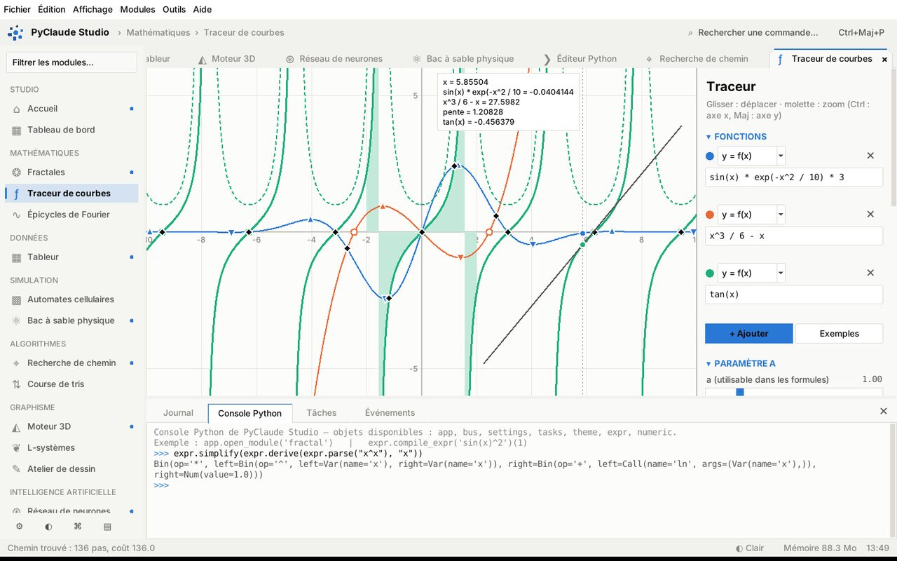
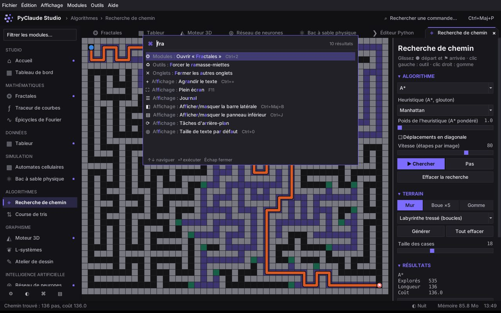

# PyClaude Studio

**Un atelier scientifique et créatif complet, écrit en Python pur avec Tkinter.**
Plus de seize mille lignes de code, quatorze modules, aucune dépendance obligatoire.



PyClaude Studio est une application de bureau à onglets dont chaque module est
un plugin : explorateur de fractales multicœur, tableur réactif, moteur 3D
logiciel, réseau de neurones entraîné en direct, simulation physique
Barnes-Hut, éditeur de code… Le tout repose sur un noyau commun (bus
d'événements, registre de commandes, tâches d'arrière-plan, thèmes, sessions)
et sur des moteurs de calcul écrits de zéro et couverts par des tests.

## Démarrage

```bash
python run.py                 # ou : python -m pyclaude_studio
```

Python 3.9 ou plus récent, avec Tkinter (fourni par défaut sous Windows et
macOS ; sous Debian/Ubuntu : `sudo apt install python3-tk`).
**numpy est facultatif** : s'il est installé, le rendu des fractales est
vectorisé ; sinon un moteur multiprocessus en Python pur prend le relais.

Options utiles :

| Option | Effet |
|---|---|
| `--module fractal` | ouvre un module au démarrage (répétable) |
| `--theme Clair` | choisit le thème (Nuit, Clair, Océan, Néon, Forêt, Sable) |
| `--fresh` | ne restaure pas la session précédente |
| `--safe-mode` | sans plugins utilisateur ni restauration |
| `--selftest` | ouvre chaque module, vérifie l'absence d'erreur, puis quitte |
| `--reset` | réinitialise tous les réglages |

Installation en tant que commande : `pip install .` puis `pyclaude-studio`.

## Les modules

| Module | Ce qu'il fait |
|---|---|
| **Fractales** | Mandelbrot, Julia, Burning Ship, Tricorne, Multibrot, Newton. Rendu progressif en arrière-plan (aperçu ¼ puis pleine résolution), trois moteurs interchangeables (numpy, multiprocessus, thread) qui produisent des images identiques, zoom molette / cadre / clic, historique, « Julia en ce point », orbite de z au survol, 8 palettes avec cyclage animé, export PNG et PNG ×2. |
| **Traceur de courbes** | Courbes cartésiennes, polaires et paramétriques, paramètre `a` animable. Dérivée symbolique affichée et tracée, racines, extrema, intersections, intégrale de Simpson avec aire colorée, tangente au curseur. |
| **Épicycles de Fourier** | Dessinez une forme : une FFT radix-2 la décompose en cercles tournants qui la redessinent ; spectre et erreur de reconstruction. |
| **Tableur** | Grille virtuelle de 500 × 52 cellules, formules `=SOMME(A1:B3)`, `SI`, `NB.SI`, `SOMME.SI`, `RECHERCHEV`, `SIERREUR`… (noms français et anglais, séparateur `;`), recalcul incrémental par ordre topologique, cycles détectés par Tarjan, références colorées, copier-coller avec décalage des références (`$A$1`), recopie vers le bas, annuler/rétablir, colonnes redimensionnables, graphique de la sélection, CSV/JSON. |
| **Automates cellulaires** | Jeu de la vie et 11 règles (HighLife, Day & Night, cerveau de Brian…), règles B/S et « Generations » personnalisables, motifs célèbres (canon de Gosper, pulsar…), import/export RLE, coloration par âge, courbe de population. |
| **Bac à sable physique** | Tissu déchirable (intégration de Verlet, coloration de la tension), collision de galaxies (arbre de **Barnes-Hut**, intégrateur saute-mouton, fusion des corps, affichage de l'arbre), billes (hachage spatial, impulsions). |
| **Recherche de chemin** | A* (heuristique et poids réglables), Dijkstra, glouton, BFS, BFS bidirectionnel, DFS ; six générateurs de labyrinthes (exploration récursive, Prim, Kruskal, division récursive, tressé, aléatoire) ; boue ×5, diagonales, comparaison chiffrée des algorithmes, recalcul en direct en déplaçant le départ. |
| **Course de tris** | 17 algorithmes instrumentés en course sur jusqu'à 4 couloirs, avec comparaisons, écritures et classement. |
| **Moteur 3D** | Rendu logiciel sur canevas : arcball à quaternions avec inertie, Blinn-Phong, brouillard, style « toon », élimination des faces arrière, algorithme du peintre, nœud de trèfle, bouteille de Klein, surfaces `z = f(x, y)`, import/export OBJ. |
| **L-systèmes** | Grammaires éditables, déterministes ou stochastiques, croissance animée, export SVG. |
| **Atelier de dessin** | Dessin vectoriel : crayon lissé, formes, polygones, texte, symétrie kaléidoscopique, sélection, plans, annulation illimitée, export SVG et PostScript. |
| **Réseau de neurones** | Perceptron multicouche écrit de zéro : rétropropagation vérifiée par différences finies, Adam ou SGD avec moment, L2, mini-lots ; frontière de décision, carte d'activation de **chaque neurone**, pertes d'entraînement et de test. |
| **Éditeur Python** | Coloration syntaxique, numéros de ligne, structure du code (AST), diagnostic de syntaxe en direct, indentation automatique, commentaires, recherche/remplacement (regex), exécution isolée en sous-processus avec sortie en continu, ou exécution dans la console du studio. |
| **Tableau de bord** | Processeur, mémoire, latence de la boucle Tk, débit du bus d'événements, tâches et modules ouverts, en temps réel. |

<p>








</p>

## L'environnement

* **Palette de commandes** (`Ctrl+Maj+P` ou `F1`) : recherche floue insensible
  aux accents, priorité aux commandes récentes, toutes les actions de tous les
  modules.
* **Onglets** réordonnables par glisser-déposer, fermeture au clic du milieu,
  `Ctrl+Maj+T` pour rouvrir le dernier onglet fermé, `Ctrl+1…9` pour ouvrir un module.
* **Panneau inférieur** (`Ctrl+J`) : journal filtrable, **console Python**
  intégrée avec accès à l'objet `app`, gestionnaire de tâches (annulables) et
  moniteur du bus d'événements.
* **Six thèmes**, couleur d'accent personnalisable, taille du texte réglable
  (`Ctrl+=` / `Ctrl+-`) ; les graphiques utilisent une palette catégorielle
  validée pour le daltonisme.
* **Sessions** : onglets ouverts et état de chaque module restaurés au démarrage ;
  export/import de session.
* **Visite guidée** (Outils) et **autotest** de tous les modules.



## Architecture

```
pyclaude_studio/
├── app.py            fenêtre principale, cycle de vie des modules, menus, sessions
├── core/             services sans interface (sauf thème et classe de module)
│   ├── expr.py       analyseur de Pratt, AST, compilation sûre, dérivation, simplification
│   ├── eventbus.py   publication/abonnement à motifs, sûr entre threads
│   ├── commands.py   registre unique : menus, raccourcis contextuels, palette
│   ├── tasks.py      pool de threads, progression, résultats partiels, annulation
│   ├── module.py     classe StudioModule, boucles d'animation, découverte des plugins
│   ├── theme.py      thèmes, polices nommées, habillage ttk complet
│   └── …             réglages, couleurs, images (PNG sans Pillow), numérique, 3D, recherche floue
├── engines/          moteurs de calcul purs, testés sans interface
├── ui/               composants : barre d'onglets, palette, notifications, console, graphiques
└── modules/          un fichier par module (plugin découvert automatiquement)
```

Quelques choix techniques :

* **Aucun appel Tk hors du thread principal** : les tâches communiquent par
  files pompées depuis la boucle Tk.
* **Images sans Pillow** : rendu en tampon RGB, affichage via le format PPM
  natif de Tk, encodeur PNG maison (zlib + CRC). Les fractales sont stockées en
  image *indexée* et recolorées par `bytes.translate` en C, ce qui permet de
  changer de palette ou de la faire défiler sans rien recalculer.
* **Expressions compilées en Python** : l'AST validé est traduit en fonction
  Python sans aucun builtin accessible, puis exécuté des milliers de fois par
  seconde (traceur, surfaces 3D).
* **Les boucles d'animation** sont suspendues automatiquement quand leur onglet
  est masqué.

## Écrire un plugin

Un module est une sous-classe de `StudioModule`. Déposez un fichier `.py` dans
le dossier `plugins` de la configuration (chemin affiché dans Réglages ›
Données) : il apparaît au prochain démarrage dans la barre latérale, l'accueil
et la palette. Exemple complet : [`examples/plugins/horloge.py`](examples/plugins/horloge.py).

```python
from pyclaude_studio.core.module import StudioModule
from pyclaude_studio.ui.widgets import themed_canvas

class Bonjour(StudioModule):
    id = "bonjour"
    title = "Bonjour"
    icon = "☺"
    category = "Plugins"

    def build(self, frame):
        self.canvas = themed_canvas(frame)
        self.canvas.pack(fill="both", expand=True)
        self.loop(self.draw, fps=30).start()   # mise en pause hors de l'onglet

    def draw(self, dt):
        c, t = self.canvas, self.theme
        c.delete("all")
        c.create_text(200, 100, text="Bonjour !", fill=t.accent, font="StudioDisplay")
```

## Tests

```bash
python -m unittest discover -s tests -t .
```

65 tests : moteur d'expressions (priorités, dérivées vérifiées numériquement,
sécurité de la compilation), tableur (propagation, cycles, erreurs, CSV/JSON),
fractales (les trois moteurs donnent la même image), motifs du jeu de la vie
(périodes et déplacements), labyrinthes (arbres couvrants), optimalité de A*,
Barnes-Hut contre calcul direct, conservation de la quantité de mouvement,
orientation des maillages, gradient du réseau de neurones contre différences
finies, FFT contre DFT… Les deux tests d'interface s'exécutent dès qu'un
affichage est disponible (ignorés sinon).
